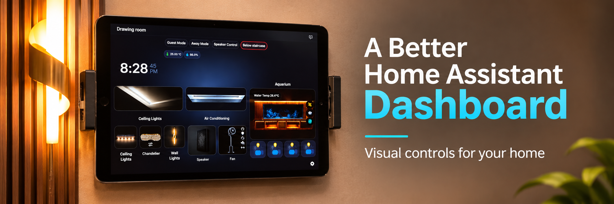

# A Better Home Assistant Dashboard

A visual, image-led Home Assistant dashboard template inspired by a real drawing-room setup. Instead of relying only on generic icons and entity labels, the view uses images of devices and state-dependent images to make controls easier to recognise.

> **Template notice:** This repository is a starting point, not a one-click install. The YAML contains neutral `replace_me_*` entity IDs and a `YOUR_HA_USERNAME` placeholder. Map them to your own Home Assistant entities before use.

## What’s included

- `dashboard.yaml` — dashboard configuration with placeholder entity IDs.
- `assets/` — image assets referenced by the dashboard.
- `docs/ENTITY-MAPPING.md` — placeholder-to-purpose mapping guide.
- `docs/INSTALLATION.md` — installation and setup instructions.
- `LICENSE` — MIT License for the project configuration.

## Features

- Image-based controls for lighting, air conditioning, speaker, fan, and aquarium.
- Conditional images that reflect reported entity state.
- Aquarium temperature and control tiles.
- Dashboard chips and room-mode controls.

## Requirements

This configuration uses Home Assistant Lovelace cards and resources including:

- Button Card (`custom:button-card`)
- Mushroom cards (`custom:mushroom-chips-card`, `custom:mushroom-light-card`)
- Bubble Card (`custom:bubble-card`)
- Sonos Card (`custom:sonos-card`)
- Card-mod (`card_mod`)
- Browser Mod (`browser_mod`)
- Clock card (`type: clock`)
- The `Frosted Glass Dark Lite` theme

Install the resources through HACS or their respective project instructions, and make sure the theme is installed and selected. The dashboard also expects your own matching Home Assistant entities, helpers, and scripts.

## Installation

Follow [`docs/INSTALLATION.md`](docs/INSTALLATION.md), then map the placeholders using [`docs/ENTITY-MAPPING.md`](docs/ENTITY-MAPPING.md).

## Customise it

You can replace the images in `assets/` with your own device photos or AI-prepared images, change the layout, rename cards, and adapt actions to your devices. Keep filenames in sync with the paths in `dashboard.yaml`, or update those paths too.

## Privacy and safety

The public YAML has been sanitised to replace the original entity IDs and kiosk-mode username with placeholders. Review the files before publishing and avoid committing Home Assistant backups, tokens, passwords, private URLs, or unredacted screenshots.

## License

The dashboard configuration is released under the MIT License. Image assets may have separate rights; see [`ASSET-LICENSE.md`](ASSET-LICENSE.md) before reusing them.
